# 御坂弹幕服务 v2.9.0 架构概览

> 本文按 v2.9.0 实际代码整理，描述模块划分和主要调用链，供阅读代码和新增功能时定位。
> 分层规范和导入约束以 `docs/最终架构规范.md` 为准；本文只描述「现在是怎样的」，不表示全仓库都已符合规范。

## 1. 总体分层

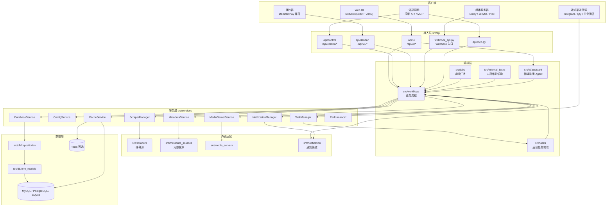

主调用方向：

```text
API / Job / Webhook → Workflow → Service → DatabaseService → Repository → ORM
                         └→ TaskManager.submit_task() → tasks/* → Workflow
```

- API 只做协议、鉴权、参数校验和响应构造。
- Workflow 负责业务顺序和跨服务编排。
- Service 提供状态、连接和底层能力，不反向导入 Workflow 或 Tasks；需要回调时由组合根注入。
- 2.9.0 移除了 `src/db/crud`，数据库访问统一经 `DatabaseService` 暴露的 Repository。`src/repositories/` 目录已为空。

## 2. 目录与模块职责

| 层 | 目录 | 职责 |
|---|---|---|
| 入口 | `src/main.py` | 创建 FastAPI，挂载路由、MCP、静态资源与前端 |
| 组合根 | `src/core/app_lifecycle.py` | 启动/关闭顺序，创建并注入全部服务 |
| 核心配置 | `src/core/` | 环境变量、默认配置 `default_configs.py`、日志 `logging_setup.py`、缓存驱动、代理、时区 |
| 接入 | `src/api/ui/` | Web UI 接口（搜索、库、任务、设置、助手、通知、性能等） |
| 接入 | `src/api/control/` | 外部控制 API（导入、搜索、配置） |
| 接入 | `src/api/dandan/` | DanDanPlay 兼容接口（search / match / bangumi / comments） |
| 接入 | `src/api/webhook_api.py`、`src/webhook/` | 媒体服务器 Webhook 入口与 Emby / Jellyfin / Plex 解析适配 |
| 编排 | `src/workflows/` | 搜索、匹配、导入、刷新、弹幕、日历、通知、系统信息、资源包等流程 |
| 编排 | `src/tasks/` | 提交给 TaskManager 的后台任务实现，`registry.py` 注册处理器 |
| 编排 | `src/jobs/` | APScheduler 定时任务（增量刷新、补全缺集、订阅扫描、Webhook 延时处理、备份等） |
| 编排 | `src/internal_tasks/` | 内部轮询（性能采集、资源包更新、每日汇总、Token 刷新） |
| 编排 | `src/ai/` | AI 匹配/纠错（`ai_matcher.py` 等）与御坂助手（`ai/assistant/`） |
| 服务 | `src/services/` | 数据库、配置、缓存、文件、任务、弹幕源、元数据、媒体服务器、通知、性能、调度 |
| 适配 | `src/scrapers/` | 各平台弹幕源，`base.py` 为公共契约；源码来自资源包，二进制源需校验 |
| 适配 | `src/metadata_sources/` | TMDB / Bangumi / 豆瓣 / IMDb / TVDB / Trakt / 360 / AniBT |
| 适配 | `src/media_servers/` | Emby / Jellyfin / Plex 客户端 |
| 适配 | `src/notification/` | 渠道实现（telegram / wechat / qqbot / serverchan）、事件、模板解析、订阅匹配、聚合、交互菜单 |
| 数据 | `src/db/` | ORM、Repository、迁移、数据库维护 |
| 支撑 | `src/schemas/` | Pydantic 请求/响应模型与枚举 |
| 支撑 | `src/utils/` | 无状态工具：解析、运行时、诊断、图片处理 |
| 支撑 | `src/tools/` | 给 AI 和排障用的只读数据库/性能查询工具 |
| 前端 | `web/src/` | React 前端，构建产物由 `src/frontend.py` 挂载 |

## 3. 启动流程

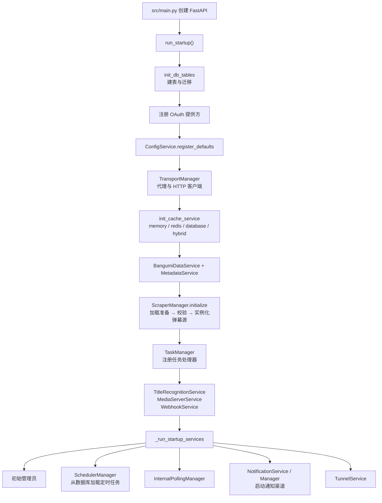

依赖由 `app_lifecycle.py` 统一创建并放入 `app.state` 与 `service_container`，避免服务之间互相导入。

## 4. 数据、配置与缓存

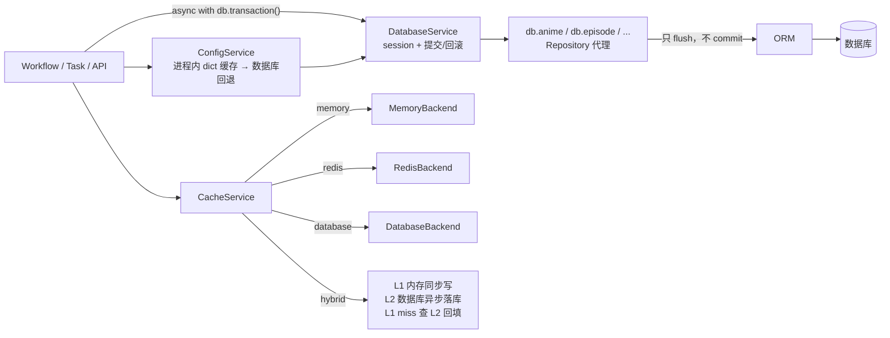

- 数据库入口是 `get_database_service()`，调用方用 `db.transaction()` 声明事务。
- 2.9.0 移除了各模块自己的进程内缓存（搜索结果、元数据、AI 等），统一改用 `CacheService` 的 region + TTL。`ConfigService` 仍保留自己的配置缓存，属于配置服务内部实现。
- 文件读写走 `FileStorageService`；弹幕文件写入路径由 `workflows/danmaku_paths.py` 选择，OVA / 综艺 / 短剧可按弹幕存储配置分别使用目录和命名模板。

## 5. 后台任务

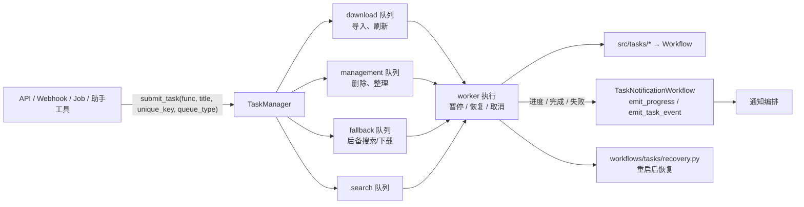

- `TaskManager` 管理通用后台任务；`DownloadTaskManager` 只管理弹幕源资源包下载，两者独立。
- 任务通知按 `unique_key` 前缀分类（导入、刷新、自动导入、媒体扫描等），分类逻辑在 `src/workflows/task_notification.py`。
- 定时任务由 `SchedulerManager` 调度 `src/jobs/*`，每个 Job 只负责触发，业务交给 Workflow 或提交任务。

## 6. 搜索与导入

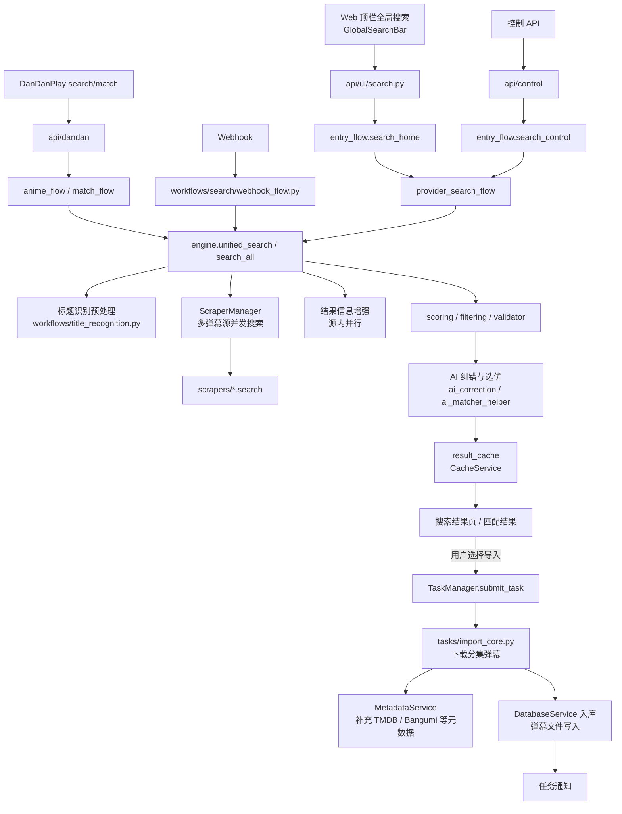

- 2.9.0 起搜索入口统一为顶栏全局搜索栏，支持搜索历史、精确季集搜索和多数据源；接口测试独立为 `api-test` 页面。
- 媒体类型扩展为电视剧、电影、OVA、综艺、短剧；无法判定时交给 AI 补全。
- 后备搜索（`fallback_search.py`）在匹配失败时提交到 fallback 队列，结果写回缓存供 DanDanPlay 客户端再次请求。

## 7. Webhook 流程

```mermaid
flowchart LR
    MS["Emby / Jellyfin / Plex"] --> API["webhook_api.py"]
    API --> PARSE["WebhookService.parse<br/>src/webhook/* 适配器"]
    PARSE --> EVT["WebhookEvent<br/>入库 / 删除"]
    EVT --> DELAY["延时队列"]
    DELAY --> JOB["jobs/webhook_processor.py<br/>WebhookProcessorJob"]
    JOB --> FLOW["workflows/search/webhook_flow.py<br/>库内匹配 → 搜索 → 选源"]
    FLOW --> TASK["tasks/webhook.py<br/>提交导入任务"]
    TASK --> NOTI["任务通知"]
```

## 8. 弹幕源资源包

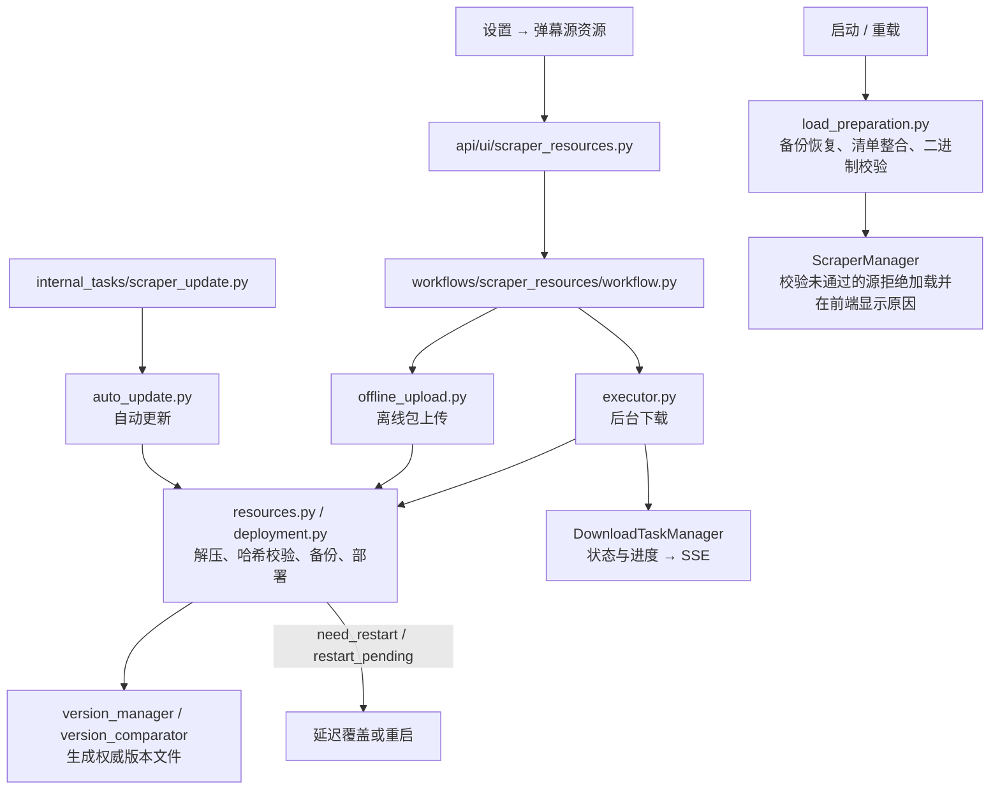

- 2.9.0 起二进制源在加载前按权威版本文件校验（是否在清单、版本、哈希、架构），未通过的源不会加载。
- `min_server_version` 为可选字段，缺失时不再导致全部源被拒。

## 9. 通知系统

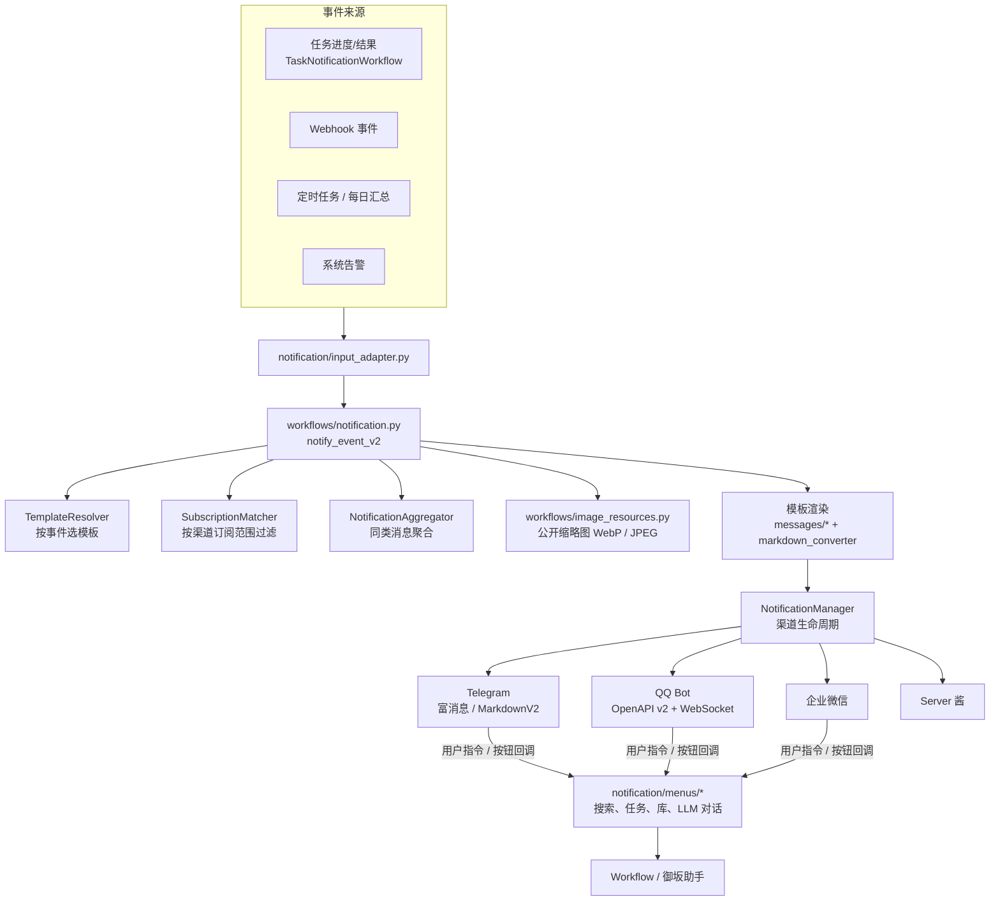

- 2.9.0 新增任务进度模板，通知订阅统一迁移到 V2 配置，按范围动态开关。
- 每个渠道声明 `public_image_format`，不支持 WebP 的渠道（如 Telegram、QQ、企业微信）收到 JPEG 缩略图。

## 10. 御坂助手

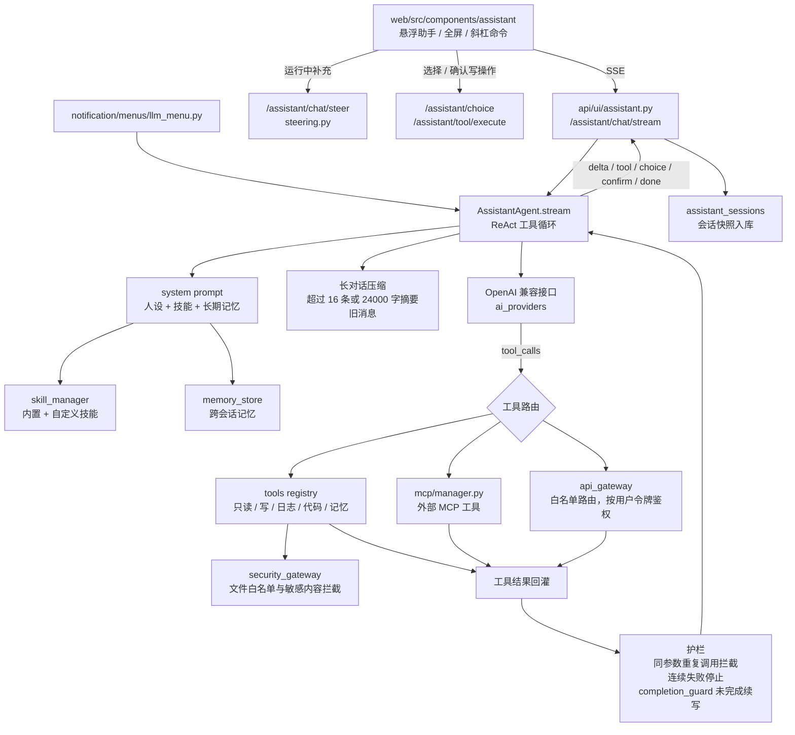

## 11. 系统信息与性能

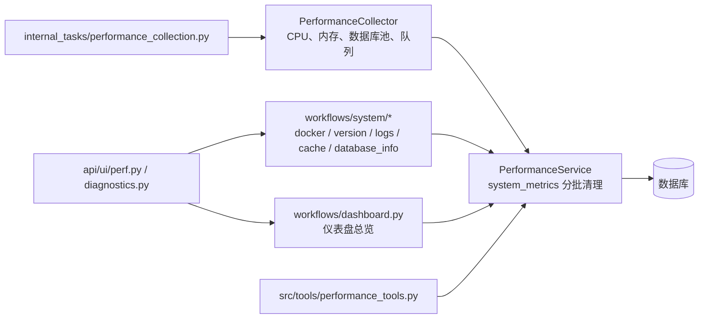

- 容器统计改为流式采样。
- 2.9.0 增加内存归还和指标清理，修复临时 logger 永久注册导致的内存增长。

## 12. 前端结构

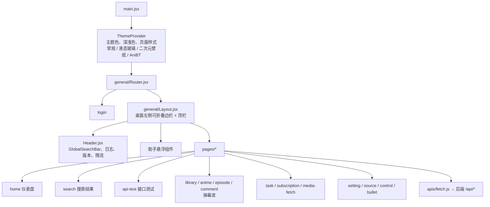

- 生产环境前端构建产物由 `src/frontend.py` 挂载；开发环境重定向到 Vite 开发服务器。
- 二级 Tab 统一使用 `.page-tabs` 样式，Tab 内容首元素上边距由 `web/src/index.css` 统一清零。

## 13. 新增代码放在哪里

| 要做的事 | 放在 |
|---|---|
| 新接口 | `src/api/ui` 或 `src/api/control`，只做参数和响应 |
| 新业务流程 | `src/workflows/` |
| 耗时操作 | 写在 `src/tasks/`，通过 `TaskManager.submit_task()` 提交 |
| 定时触发 | `src/jobs/` 新增 `BaseJob` 子类 |
| 数据库查询 | `src/db/repositories/`，经 `DatabaseService` 调用 |
| 缓存 | `CacheService`，不要在模块里自建字典缓存 |
| 新通知渠道 | `src/notification/` 继承 `BaseNotificationChannel` |
| 新助手工具 | `src/ai/assistant/tools/`，注册到 `registry` |
| 纯函数工具 | `src/utils/` |
